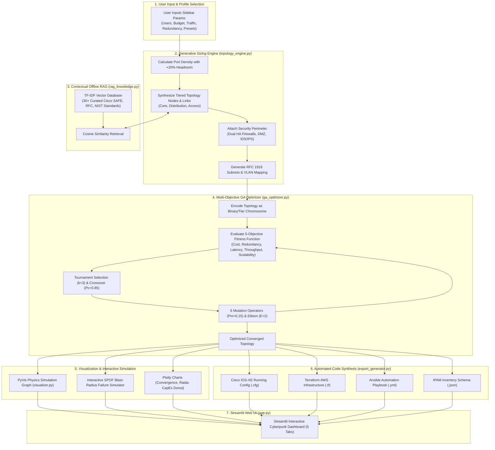

# 🌐 NetGenAI — Complete Project In-Depth Guide (Hindi + English)

> **NetGenAI (Network Generation AI)**: Ek autonomous, Generative AI aur Genetic Algorithm-powered platform jo enterprise network topology design, multi-objective optimization, real-time failure simulation, aur Infrastructure-as-Code (IaC) configuration synthesis ko automate karta hai.

---

## 📑 Table of Contents (विषय सूची)

1. [Quick Summary — Ye Project Kya Hai Aur Kya Karta Hai?](#1-quick-summary--ye-project-kya-hai-aur-kya-karta-hai)
2. [Real-World Problem — Industry Me Iski Zaroorat Kyu Hai?](#2-real-world-problem--industry-me-iski-zaroorat-kyu-hai)
3. [Core Technical Concepts (Aasan Bhasha Me)](#3-core-technical-concepts-aasan-bhasha-me)
4. [High-Level Architecture Aur End-to-End Workflow](#4-high-level-architecture-aur-end-to-end-workflow)
5. [9 Network Topologies — Detail Explanation in Hindi-English](#5-9-network-topologies--detail-explanation-in-hindi-english)
6. [Complete Codebase Deep-Dive (Har File Ka Post-Mortem)](#6-complete-codebase-deep-dive-har-file-ka-post-mortem)
   - [6.1 `network_models.py` — Hardware Catalog, Link Specs & Enums](#61-network_modelspy--hardware-catalog-link-specs--enums)
   - [6.2 `topology_engine.py` — Procedural Sizing & Failure Simulation](#62-topology_enginepy--procedural-sizing--failure-simulation)
   - [6.3 `ga_optimizer.py` — Genetic Algorithm Optimization Engine](#63-ga_optimizerpy--genetic-algorithm-optimization-engine)
   - [6.4 `rag_knowledge.py` — Offline Vector RAG & Industry Standards](#64-rag_knowledgepy--offline-vector-rag--industry-standards)
   - [6.5 `visualizer.py` — PyVis Physics Simulation & Plotly Analytics](#65-visualizerpy--pyvis-physics-simulation--plotly-analytics)
   - [6.6 `export_generator.py` — Cisco IOS, Terraform, Ansible, IPAM](#66-export_generatorpy--cisco-ios-terraform-ansible-ipam)
   - [6.7 `app.py` — Streamlit Cyberpunk UI & Reactive State](#67-apppy--streamlit-cyberpunk-ui--reactive-state)
   - [6.8 `test_suite.py` & `generate_report.py` — Testing & DOCX Generator](#68-test_suitepy--generate_reportpy--testing--docx-generator)
7. [Mathematical Formulas Aur Algorithms (Step-by-Step Proofs)](#7-mathematical-formulas-aur-algorithms-step-by-step-proofs)
   - [7.1 "Five Nines" (99.999%) Availability Formula](#71-five-nines-99999-availability-formula)
   - [7.2 Oversubscription Ratio Calculation](#72-oversubscription-ratio-calculation)
   - [7.3 Genetic Algorithm Multi-Objective Fitness Formula](#73-genetic-algorithm-multi-objective-fitness-formula)
   - [7.4 TF-IDF Vector Search & Cosine Similarity Mathematics](#74-tf-idf-vector-search--cosine-similarity-mathematics)
   - [7.5 Graph Cut-Vertex & Blast-Radius Calculation (Tarjan's DFS)](#75-graph-cut-vertex--blast-radius-calculation-tarjans-dfs)
8. [Hardware Device Catalog (18 Real-World Devices Table)](#8-hardware-device-catalog-18-real-world-devices-table)
9. [Application User Interface (UI) Walkthrough (5 Tabs Explained)](#9-application-user-interface-ui-walkthrough-5-tabs-explained)
10. [Project Ko Run, Test Aur Deploy Kaise Kare?](#10-project-ko-run-test-aur-deploy-kaise-kare)
11. [Top Viva & Technical Interview Questions with Answers (Examiner Favorites)](#11-top-viva--technical-interview-questions-with-answers-examiner-favorites)

---

## 1. Quick Summary — Ye Project Kya Hai Aur Kya Karta Hai?

Maan lijiye kisi company ko apne 1,000 employees ke liye ek naya office IT network setup karna hai. Normal tarike se ek senior Network Architect ko ye kaam karne me **2 se 3 hafte** lag jaate hain:
- Kitne Core Switches, Distribution Switches aur Access Switches khareedne hain?
- Kaunse models (Cisco Catalyst 9500, Nexus 9300 ya budget EdgeCore) budget me fit baithenge?
- Cables ko kaise connect karein taaki agar koi 1 cable ya switch kharab bhi ho jaye, toh pura office band na ho (**Redundancy & High Availability**)?
- Security ke liye Firewalls, DMZ, aur VLANs kaise set karein taaki company PCI-DSS ya HIPAA compliance fail na kare?
- Har ek switch ke liye 100-150 lines ke complex Cisco CLI commands manually type karna.

### 🚀 NetGenAI Is Pura Process Ko 5 Seconds Me Automate Karta Hai:
1. **User Input Dijiye**: Users kitne hain, budget kitna hai, traffic high hai ya normal, aur kaunsi compliance (PCI-DSS, HIPAA) chahiye.
2. **Generative Sizing Engine**: 20% future growth margin jodkar mathematically calculate karta hai ki kitne switches aur redundant links chahiye.
3. **Offline RAG Knowledge Engine**: 30+ official networking standards (Cisco SAFE, RFC 7938, NIST Zero Trust) ko scan karke engineering best-practices recommend karta hai.
4. **Genetic Algorithm (GA) Optimizer**: AI evolution chala kar 50 generations me cost, latency, throughput aur redundancy ka best balance (Pareto-optimal solution) dhoondta hai.
5. **Interactive Failure Simulator**: Screen par kisi bhi router ya switch ko click karke "Fail/Kill" kijiye — system turant batayega ki network ka kitna hissa down hua (**Blast Radius**).
6. **One-Click Code Generator (IaC)**: Ready-to-deploy Cisco IOS-XE switch configs, AWS Terraform scripts (`main.tf`), Ansible playbooks (`playbook.yml`), aur IPAM JSON sheets generate kar deta hai.

---

## 2. Real-World Problem — Industry Me Iski Zaroorat Kyu Hai?

IT industry me manual network designing me aane wali sabse badi problems aur NetGenAI ka solution:

| Industry Ka Real Problem | Manual Kaam Me Kya Gadbad Hoti Hai? | NetGenAI Kaise Solve Karta Hai? |
|---|---|---|
| **Human Sizing Errors** | Engineers switch port capacity ya oversubscription ratio ka andaza lagate hain, jisse peak office hours me network choke ho jata hai. | Exact mathematical formulas se port density aur 20% future buffer calculate karta hai. |
| **Single Point of Failure (SPOF)** | Agar ek single core router ya cable fail hui, toh pura building/campus offline ho jata hai. | Graph Theory (Biconnected Components) use karke dual-homed redundant links guarantee karta hai. |
| **Budget Mismanagement** | Chhote branch office me mehenge 100G switches daal dena, ya bade data center me saste 1G switches lagakar packet drops karwana. | Budget slider ke hisaab se automatic Tier selection karta hai (Budget, Standard, Enterprise). |
| **Security & Compliance Violations** | Payment servers (PCI-DSS) ya medical data (HIPAA) ko bina isolated DMZ ke open LAN me daal dena. | Compliance select karte hi automatically Dual HA Firewalls, IDS/IPS aur DMZ VLANs generate kar deta hai. |
| **Slow Manual CLI Configuration** | Har switch ke andar console cable lagakar manual command likhna — jisme typos aur syntax errors ki wajah se outages aate hain. | 100% production-ready Cisco configs, Terraform scripts, aur Ansible playbooks ek click me generate karta hai. |

---

## 3. Core Technical Concepts (Aasan Bhasha Me)

Coding samajhne se pehle ye 6 core concepts samajhna bohot zaroori hai:

### 🔹 1. Network Topology (Graph Model)
Network topology ka matlab hai ki devices physically aur logically kaise jude hue hain.
- **Nodes (Vertices)**: Network ke physical hardware devices (Routers, Switches, Firewalls, Servers).
- **Edges (Links)**: Unhe jodne wali cables (Cat6a copper, OM4 Multimode Fiber, OS2 Singlemode Fiber).

### 🔹 2. Generative Architectural Sizing
Ye koi static (fixed) diagram nahi hai. Agar aap user slider ko 200 se badhakar 1,200 karenge, toh system internally math run karta hai:
$$\text{Access Switches Required} = \left\lceil \frac{\text{Users} \times 1.20 \text{ (20\% Headroom)}}{\text{Usable Ports per Switch}} \right\rceil$$
Agar ek switch me 48 ports hain aur 8 ports uplinks ke liye reserved hain (usable = 40), toh 1,000 users ke liye:
$$\left\lceil \frac{1000 \times 1.20}{40} \right\rceil = 30 \text{ Switches}$$
System automatically 30 access switches, unke distribution aggregates aur core routers generate karega!

### 🔹 3. Genetic Algorithm (Evolutionary AI)
- **Concept**: Jaise nature me Charles Darwin ki theory hoti hai (*Survival of the Fittest*), waise hi computer me GA kaam karta hai.
- Ek network design ko hum **Chromosome** kehte hain.
- System initially 20 alag-alag network designs generate karta hai (**Population**).
- Har generation me best designs ko select kiya jata hai (**Tournament Selection**), unke achhe features ko aapas me mix kiya jata hai (**Crossover**), aur kuch naye smart changes kiye jaate hain (**Mutation**).
- 50 generations ke baad mathematically best network design mil jata hai.

### 🔹 4. RAG (Retrieval-Augmented Generation)
- **Concept**: Open-book exam ki tarah. System ke paas ek offline curated library hai jisme 30+ official network standards (Cisco SAFE, RFC 7938, NIST Zero Trust) saved hain.
- Jab aap topology banate hain, toh **TF-IDF Vector Search** run hota hai aur matching standard rules nikaal kar screen par dikhata hai.

### 🔹 5. Blast Radius & Cut-Vertex (Graph Theory)
- Graph theory me **Cut-Vertex** (ya Articulation Point) wo device hota hai jisko agar nikaal diya jaye, toh graph do alag-alag tukdon me toot jata hai.
- Agar koi router Cut-Vertex hai, iska matlab wahi aapka **Single Point of Failure (SPOF)** hai!
- **Blast Radius**: Kisi device ke marne par network ka kitna percentage connection khatam ho gaya. NetGenAI iska real-time calculation karta hai.

### 🔹 6. "Five Nines" (99.999%) High Availability
Enterprise IT me 99.999% uptime golden standard maana jata hai. Pure saal (8,760 hours) me sirf **5 minute 15 second** ka downtime allowed hota hai. NetGenAI redundant parallel devices deploy karke Five Nines achieve karta hai.

---

## 4. High-Level Architecture Aur End-to-End Workflow

NetGenAI ka end-to-end dataflow pipeline is flowchart me summarize kiya gaya hai:



---

## 5. 9 Network Topologies — Detail Explanation in Hindi-English

NetGenAI me 9 standard network architectures supported hain:

### 1. Cisco 3-Tier Hierarchical (Core, Distribution, Access)
- **Structure**:
  - **Core Layer**: Super high-speed optical backbone (40G/100G fiber). Iska ek hi kaam hota hai — bina kisi delay ke packets ko maximum speed par route karna. Yahan koi security filtering ya packet inspection nahi hoti.
  - **Distribution Layer**: Ye middle layer hoti hai jo Access switches ko aggregate karti hai, VLANs ke beech me routing karti hai, aur Access Control Lists (ACLs) / QoS policies enforce karti hai.
  - **Access Layer**: Ground-floor switches jahan employees ke PCs, laptops, IP phones, aur Wi-Fi Access Points connect hote hain.
- **Traffic Pattern**: **North-South** (User desk se bahar Internet ya central servers ki taraf).
- **Kab Use Karein**: University campuses, corporate headquarters, hospitals (500 se 5,000+ users).

### 2. Spine-Leaf (Clos) Architecture
- **Structure**: Modern data centers ka standard design. Isme do layers hoti hain:
  - **Spine Switches**: Top layer jo saare Leaf switches se judti hai. Spines aapas me kabhi connect nahi hote.
  - **Leaf Switches**: Bottom layer jo servers aur storage racks se judti hai. Leaves bhi aapas me direct connect nahi hote. Har Leaf switch **har ek Spine switch** se connected hota hai.
- **Kyu Best Hai**: Har server kisi bhi doosre server se **exact 2 hops** ki doori par hota hai. Zero bottlenecks!
- **Traffic Pattern**: **East-West** (Server-to-server, microservices, container communication).
- **Kab Use Karein**: Cloud Data Centers, AI/ML GPU training clusters (AWS, Azure, Google Cloud style).

### 3. Collapsed Core
- **Structure**: Core Layer aur Distribution Layer ko aapas me merge karke ek single redundant Layer-3 switch pair bana diya jata hai.
- **Fayda**: Hardware ka kharcha aur power consumption 40% tak kam ho jati hai, jabki gateway redundancy (HSRP/VRRP) bani rehti hai.
- **Kab Use Karein**: Medium-sized businesses (50 se 500 users) jinka budget dedicated core routers lene ka nahi hota.

### 4. Fat-Tree ($k$-ary Clos)
- **Structure**: Saste identical $k$-port commodity switches ko pods me arrange karke banaya jata hai.
- **Fayda**: Full Bisectional Bandwidth deta hai (matlab network me koi bottleneck nahi hota) bina kisi ultra-expensive proprietary switch ko khareede.
- **Kab Use Karein**: High-Performance Computing (HPC) labs, supercomputing clusters.

### 5. Full Mesh
- **Structure**: Har ek device har dusre device se dedicated cable ke through juda hota hai.
  $$\text{Total Cables} = \frac{n(n-1)}{2}$$
- **Fayda**: Maximum possible redundancy. Agar 2-3 cables cut bhi ho jayein, tab bhi traffic doosre raaste se nikal jayega.
- **Nuksan**: Cables ka kharcha bohot zyada hota hai ($n=20$ devices ke liye 190 cables!).
- **Kab Use Karein**: Military defense networks, stock exchange core backbones.

### 6. Partial Mesh
- **Structure**: Sirf critical core routers ko full mesh me joda jata hai, aur baaki edge switches ko dual links diye jaate hain.
- **Fayda**: Full mesh jaisi 90% reliability milti hai, lekin 60% kam cabling cost me.
- **Kab Use Karein**: Multi-city WAN networks, corporate branch interconnects.

### 7. Redundant Ring
- **Structure**: Devices ek closed circular loop me jude hote hain, aur saath me ek counter-rotating backup loop hota hai.
- **Fayda**: Agar ring me kahin se bhi cable cut hoti hai, toh **ERPS (Ethernet Ring Protection Switching)** protocol under 50 milliseconds me traffic ko reverse direction me ghumakar backup loop se bhej deta hai.
- **Kab Use Karein**: Metro rail systems, smart cities, oil & gas pipelines, factory automation.

### 8. Star Topology
- **Structure**: Saare devices ek single central switch se jude hote hain.
- **Fayda**: Sabse sasta aur setup karne me sabse aasan.
- **Nuksan**: Central switch down hua toh pura office down (**Single Point of Failure**).
- **Kab Use Karein**: Small retail shops, branch offices (10–50 users).

### 9. Hybrid Architecture
- **Structure**: Multiple topologies ka combination (jaise Campus ke liye 3-Tier, Data Center ke liye Spine-Leaf, aur Branches ke liye Partial Mesh).
- **Kab Use Karein**: Multinational Enterprises.

---

## 6. Complete Codebase Deep-Dive (Har File Ka Post-Mortem)

NetGenAI ka codebase highly modular aur production-grade Python me likha gaya hai. Aaiye har ek file ko detail me samjhein:

```
CN/
├── app.py                  # Streamlit Interactive Dashboard UI
├── network_models.py       # Pydantic Schemas, 18-Device Catalog, Hardware Math
├── topology_engine.py      # NetworkX Procedural Generation & Failure Simulator
├── ga_optimizer.py         # Multi-Objective Genetic Algorithm Engine
├── rag_knowledge.py        # In-Memory TF-IDF Vector RAG & 30 Standards
├── visualizer.py           # PyVis Physics Simulation & Plotly Charts
├── export_generator.py     # Cisco CLI, Terraform HCL, Ansible, IPAM Exporters
├── test_suite.py           # Unit Testing & Quality Assurance Suite
└── generate_report.py      # Automated Comprehensive DOCX Report Generator
```

---

### 6.1 `network_models.py` — Hardware Catalog, Link Specs & Enums

Ye file pure project ka physical foundation hai. Yahan koi imaginary numbers nahi hain — Cisco, Arista, Palo Alto, aur F5 ke real-world devices, unki market price, port configurations, aur reliability figures defined hain.

#### Key Data Structures:
- **`DeviceType` Enum**: `CORE_ROUTER`, `DISTRIBUTION_ROUTER`, `ACCESS_SWITCH`, `SPINE_SWITCH`, `LEAF_SWITCH`, `FIREWALL`, `LOAD_BALANCER`, `IDS_IPS`, `DMZ_SWITCH`.
- **`NetworkTier` Enum**: `CORE`, `DISTRIBUTION`, `ACCESS`, `SPINE`, `LEAF`, `DMZ`, `SECURITY`.
- **`LinkMedia` Enum**: Cat6a Copper (1 Gbps), OM4 Multimode Fiber (10G/25G), OS2 Singlemode Fiber (40G/100G/400G).
- **`ComplianceFramework` Enum**: `PCI_DSS`, `HIPAA`, `SOC2`, `ISO_27001`, `NIST`.
- **`DeviceSpec` Dataclass**: Model name, ports, port speed, bandwidth Gbps, unit cost USD, MTBF hours, power watts, rack units (RU).

#### Mathematical Helper Functions:
1. `calculate_availability(mtbf_hours, mttr_hours=4.0)`: Formula $A = \frac{\text{MTBF}}{\text{MTBF} + 4.0}$ se exact decimal availability nikaalta hai (e.g., 0.999991).
2. `availability_to_nines(availability)`: Decimal availability ko human-readable string me convert karta hai (e.g., `"99.999% (Five Nines)"`).
3. `calculate_power_cost(watts, rate_per_kwh=0.14)`:
   $$\text{Annual Power Cost (USD)} = \frac{\text{Watts} \times 24 \times 365}{1000} \times 0.14$$

---

### 6.2 `topology_engine.py` — Procedural Sizing & Failure Simulation

Ye module Python ki `networkx` graph library use karta hai aur requirements ke hisaab se live network graph banata hai.

#### Key Functions & Workflow:
1. **`generate(requirements)`**:
   - Step 1: `requirements.num_users` ko padhta hai aur 20% growth buffer ke saath access switches calculate karta hai.
   - Step 2: Selected topology builder ko call karta hai (`_build_three_tier`, `_build_spine_leaf`, etc.).
   - Step 3: Agar user ne Security enable ki hai, toh `_add_security_perimeter()` call hota hai jo Internet Gateway aur Core ke beech me **Active/Standby Palo Alto Firewalls** aur **IDS/IPS sensors** lagata hai.
   - Step 4: `_assign_vlans_and_ipam()` call hota hai jo har tier ko RFC 1918 private IP subnets assign karta hai (e.g., Management: `10.0.1.0/24`, Servers: `10.0.2.0/24`, Corporate LAN: `10.0.3.0/24`, VoIP: `10.0.4.0/24`, DMZ: `172.16.1.0/24`).
2. **`simulate_failure(target_node_id)`**:
   - Current network graph ka deep copy banata hai.
   - User dwara select kiye gaye device (`target_node_id`) aur uske saare cables ko graph se delete kar deta hai.
   - `nx.number_connected_components(G)` check karta hai.
   - Gateway se Breadth-First Search (BFS) run karke dekhta hai ki kitne switches abhi bhi internet se jude hain aur kitne disconnect ho gaye.
   - Result me return karta hai: **Direct Severed Links**, **Isolated Devices**, aur **Surviving Connectivity %**.

---

### 6.3 `ga_optimizer.py` — Genetic Algorithm Optimization Engine

Synthesize hone ke baad initial network hamesha 100% optimal nahi hota (ho sakta hai kuch links bekar ho ya switches bohot costly ho). GA engine use evolve karta hai:

#### Chromosome Structure:
Ek network topology ko `Chromosome` object me encode kiya jata hai:
- `adjacency`: Links ka set `(source, target, bandwidth)`.
- `device_tiers`: Har device ka hardware tier (`0`: Budget, `1`: Standard, `2`: Enterprise).
- `link_redundancy`: Flags jo batate hain ki kisi link ka backup path active hai ya nahi.

#### 5-Objective Fitness Function:
$$\text{Fitness} = w_{\text{cost}} \cdot S_{\text{cost}} + w_{\text{red}} \cdot S_{\text{red}} + w_{\text{lat}} \cdot S_{\text{lat}} + w_{\text{thr}} \cdot S_{\text{thr}} + w_{\text{scale}} \cdot S_{\text{scale}}$$
(Default weights: Cost = 0.30, Redundancy = 0.25, Latency = 0.20, Throughput = 0.15, Scalability = 0.10).

#### 6 Domain-Specific Mutation Operators:
1. `mutate_add_link`: Agar graph me koi Single Point of Failure (SPOF) dikhta hai, toh backup link jod deta hai.
2. `mutate_prune_link`: Faltu ke loop-forming links ko remove karta hai taaki cabling cost bache.
3. `mutate_upgrade_device`: Agar kisi switch par traffic zyada hai, toh use higher hardware model me upgrade karta hai.
4. `mutate_downgrade_device`: Under-utilized switches ko saste models me convert karta hai taaki budget bache.
5. `mutate_scale_bandwidth`: Uplinks ko 10G se 25G ya 40G se 100G fiber me upgrade karta hai.
6. `mutate_toggle_redundancy`: Distribution uplinks par HSRP/VRRP failover switch enable karta hai.

---

### 6.4 `rag_knowledge.py` — Offline Vector RAG & Industry Standards

Slow cloud APIs (jaise OpenAI ya Gemini) par depend hone ke bajaye, NetGenAI 100% local, offline, deterministic vector search use karta hai.

- **Corpus**: 30+ structured technical standards documents hain (Cisco SAFE Campus, Arista RFC 7938 BGP, NIST SP 800-207 Zero Trust, PCI-DSS 4.0 requirement 1.3, HIPAA Security Rule, OSPF Multi-Area guidelines).
- **TF-IDF + Cosine Similarity**: Scikit-Learn ke `TfidfVectorizer` se sabhi documents ka vocabulary index banta hai. Jab user query karta hai (e.g., *"oversubscription"* ya *"firewall DMZ"*), toh Cosine Similarity calculate hoti hai aur 2 millisecond me sabse accurate standard screen par display ho jata hai.

---

### 6.5 `visualizer.py` — PyVis Physics Simulation & Plotly Analytics

Ye module network graph ko visual treat banata hai:

1. **PyVis Physics Graph**:
   - `networkx` graph ko Vis.js interactive HTML me convert karta hai.
   - **Barnes-Hut Physics Simulation**: Har device node ke paas electrostatic mass hota hai jo use dusre nodes se door dhakelta hai (nodes overlap nahi hote), aur links springs ki tarah kaam karte hain jo related switches ko natural geometric clusters me arrange kar dete hain.
   - **Tier Color Coding**:
     - 🔴 Core: `#ef4444`
     - 🟣 Spine / Data Center: `#7b2ff7`
     - 🔵 Distribution: `#00d4ff`
     - 🟢 Access: `#10b981`
     - 🟡 Security / DMZ: `#f59e0b`
   - Node par mouse hover karne se uski poori details (Model, IP, Ports, MTBF, Power) tooltip me dikhti hai.
2. **Plotly Analytics**:
   - `build_fitness_chart()`: 50 generations me Best, Average, aur Worst fitness curve dikhata hai.
   - `build_radar_chart()`: 5-axis spider radar jo initial vs. optimized metrics ko visually compare karta hai.
   - `build_cost_donut_chart()`: CapEx breakdown pie/donut chart (Core vs Access vs Security vs Cabling).

---

### 6.6 `export_generator.py` — Cisco IOS, Terraform, Ansible, IPAM

Ye module designed network ko real-world automation code me export karta hai:
1. **Cisco IOS-XE Script (`.cfg`)**: Production-ready configuration jisme `spanning-tree mode rapid-pvst`, VLAN definitions (`vlan 10, 20, 30`), 802.1Q trunk interfaces, aur OSPF routing statements hote hain.
2. **Terraform Infrastructure as Code (`main.tf`)**: HashiCorp HCL script jo AWS me ek full VPC, public/private subnets, Internet Gateway, aur route tables automate karta hai.
3. **Ansible Automation Playbook (`playbook.yml`)**: `cisco.ios.ios_config` collection use karke saare switches par ek saath configuration push karne ka YAML script.
4. **IPAM Inventory (`network_ipam.json`)**: NetBox ya SolarWinds me import karne ke liye complete node IDs, IP subnets, VLANs, aur hardware models ka structured JSON schema.

---

### 6.7 `app.py` — Streamlit Cyberpunk UI & Reactive State

Application ka main dashboard:
- Cyberpunk dark theme with glassmorphic cards aur neon status indicators.
- **Session State**: User ke inputs, generated topology, simulation results, aur GA metrics ko state me persist karta hai taaki page reload hone par data loss na ho.
- **5 Operational Tabs**: Graph Visualization, AI Reasoning & RAG, GA Evolution, BOM & Financials, aur IaC Code Exporters.

---

### 6.8 `test_suite.py` & `generate_report.py` — Testing & DOCX Generator

- **`test_suite.py`**: Python `unittest` based automated test runner jo 5 critical areas ko verify karta hai (Device Catalog validity, 9 procedural topologies generation, RAG vector retrieval accuracy, GA optimization fitness convergence, aur IaC export code correctness).
- **`generate_report.py`**: `python-docx` based automated script jo pure project ka 17-section in-depth report Microsoft Word (`.docx`) format me live benchmark data ke saath generate karta hai.

---

## 7. Mathematical Formulas Aur Algorithms (Step-by-Step Proofs)

Exam aur Viva me examiner mathematical formulas zaroor poochte hain. Yahan har formula ka detail explanation aur example diya gaya hai:

### 7.1 "Five Nines" (99.999%) Availability Formula

Kisi device ka availability formula:
$$A = \frac{\text{MTBF}}{\text{MTBF} + \text{MTTR}}$$

Jahan:
- $\text{MTBF}$ = Mean Time Between Failures (Device kharab hone se pehle kitne ghante chala).
- $\text{MTTR}$ = Mean Time To Repair (Device ko replace/reboot karne me kitna time laga, standard = 4 hours).

#### Series Connection (Bina Redundancy Ke):
Agar do switches series me jude hain (traffic dono se hokar guzarta hai):
$$A_{\text{total}} = A_1 \times A_2$$
*(Downtime badh jata hai kyunki koi bhi ek switch kharab hua toh connection cut ho jayega)*.

#### Parallel Connection (Redundant Active/Standby Pair):
Agar do core routers parallel me HSRP/VRRP ke saath lage hain:
$$A_{\text{total}} = 1 - (1 - A_1)(1 - A_2)$$

**Real Calculation Example**:
Agar ek Cisco Catalyst switch ka uptime $A_1 = 99.9\%$ ($0.999$) hai:
$$A_{\text{total}} = 1 - (1 - 0.999)(1 - 0.999) = 1 - (0.001 \times 0.001) = 1 - 0.000001 = 0.999999 \implies \mathbf{99.9999\%}$$
Yahi wajah hai ki NetGenAI hamesha dual core aur redundant uplinks deploy karta hai!

---

### 7.2 Oversubscription Ratio Calculation

Oversubscription ratio batata hai ki kitne users ke traffic ko uplink par share kiya ja raha hai:

$$\text{Oversubscription Ratio} = \frac{\sum \text{Downlink Bandwidth (Users to Access Switch)}}{\sum \text{Uplink Bandwidth (Access Switch to Distribution)}}$$

**Example Calculation**:
- Ek access switch par 40 employees ke PCs jude hain, har ek ka port speed = $1\text{ Gbps}$.
  $$\text{Total Downlink} = 40 \times 1\text{ Gbps} = 40\text{ Gbps}$$
- Switch ke paas do $10\text{ Gbps}$ SFP+ fiber uplinks hain:
  $$\text{Total Uplink} = 2 \times 10\text{ Gbps} = 20\text{ Gbps}$$
- Ratio:
  $$\text{Oversubscription} = \frac{40\text{ Gbps}}{20\text{ Gbps}} = 2:1$$
*(Cisco guidelines ke hisaab se campus me 4:1 se kam ratio excellent aur non-blocking maana jata hai)*.

---

### 7.3 Genetic Algorithm Multi-Objective Fitness Formula

GA har candidate network ko evaluate karne ke liye normalized fitness score calculate karta hai:

$$\text{Fitness} = w_{\text{cost}} \cdot S_{\text{cost}} + w_{\text{red}} \cdot S_{\text{red}} + w_{\text{lat}} \cdot S_{\text{lat}} + w_{\text{thr}} \cdot S_{\text{thr}} + w_{\text{scale}} \cdot S_{\text{scale}}$$

Jahan weights ka sum $1.0$ hota hai:
$$w_{\text{cost}} + w_{\text{red}} + w_{\text{lat}} + w_{\text{thr}} + w_{\text{scale}} = 1.0$$

Har objective ka score $[0, 1]$ ke beech normalize hota hai:
1. **Cost Score ($S_{\text{cost}}$)**:
   $$S_{\text{cost}} = \max\left(0, 1 - \frac{\text{Actual CapEx}}{\text{User Budget}}\right)$$
2. **Redundancy Score ($S_{\text{red}}$)**:
   $$S_{\text{red}} = \frac{\text{Redundant Backup Links}}{\text{Total Links}} \times \text{Biconnectivity Factor}$$
3. **Latency Score ($S_{\text{lat}}$)**:
   $$S_{\text{lat}} = \frac{1}{\text{Average Shortest Path Hops from Access to Internet Gateway}}$$
4. **Throughput Score ($S_{\text{thr}}$)**:
   $$S_{\text{thr}} = \min\left(1.0, \frac{\text{Core Backbone Bandwidth (Gbps)}}{\text{Peak Required Bandwidth (Gbps)}}\right)$$
5. **Scalability Score ($S_{\text{scale}}$)**:
   $$S_{\text{scale}} = \frac{\text{Unused Free Switch Ports}}{\text{Total Installed Hardware Ports}}$$

---

### 7.4 TF-IDF Vector Search & Cosine Similarity Mathematics

Offline RAG engine me search karne ke liye:

1. **Term Frequency ($\text{TF}$)**:
   $$\text{TF}(t, d) = \frac{\text{Term } t \text{ document } d \text{ me kitni baar aaya}}{\text{Document } d \text{ me total words kitne hain}}$$
2. **Inverse Document Frequency ($\text{IDF}$)**:
   $$\text{IDF}(t) = \log\left(\frac{1 + N}{1 + \text{Docs containing } t}\right) + 1$$
3. **Cosine Similarity ($\cos \theta$)**:
   User query vector $\mathbf{q}$ aur document vector $\mathbf{d}$ ke beech angle ka cosine:
   $$\text{Cosine Similarity} = \frac{\mathbf{q} \cdot \mathbf{d}}{\|\mathbf{q}\| \|\mathbf{d}\|} = \frac{\sum_{i=1}^{n} q_i d_i}{\sqrt{\sum_{i=1}^{n} q_i^2} \sqrt{\sum_{i=1}^{n} d_i^2}}$$

---

### 7.5 Graph Cut-Vertex & Blast-Radius Calculation (Tarjan's DFS)

Failure Simulator me kisi device $v$ ke fail hone par:
1. Subgraph $G' = G \setminus \{v\}$ create hota hai.
2. **Tarjan's Depth-First Search (DFS)** algorithm articulation points dhoondta hai using discovery time $d[u]$ aur low-link value $low[u]$:
   $$low[v] \ge d[u]$$
   Agar ye condition true hoti hai, toh node $u$ ek Cut-Vertex hai.
3. Network split hone ke baad surviving connectivity calculate hoti hai:
   $$\text{Surviving Connectivity \%} = \left(\frac{\text{Largest Connected Component Ke Nodes}}{\text{Total Nodes} - 1}\right) \times 100\%$$

---

## 8. Hardware Device Catalog (18 Real-World Devices Table)

NetGenAI me real-world hardware models use hote hain. Yahan 18 devices ka complete catalog hai:

| Device Category | Model Name | Ports & Interface Specs | Bandwidth | Price (USD) | MTBF (Hours) | Power (Watts) |
|---|---|---|---|---|---|---|
| **Enterprise Core Router** | Cisco Catalyst 9500 | 48x 25G SFP28 + 4x 100G QSFP28 | 3.2 Tbps | \$45,000 | 450,000 hrs (~51 yrs) | 650 W |
| **Data Center Core Spine** | Cisco Nexus 9300-GX | 48x 100G + 8x 400G QSFP-DD | 12.8 Tbps | \$65,000 | 500,000 hrs (~57 yrs) | 850 W |
| **High-Perf Spine Switch** | Arista 7060X | 32x 100G QSFP28 | 6.4 Tbps | \$38,000 | 420,000 hrs | 450 W |
| **Distribution Switch** | Cisco Catalyst 9300 | 48x 1G PoE+ + 4x 10G SFP+ Uplinks | 480 Gbps | \$12,500 | 380,000 hrs | 350 W |
| **Data Center Leaf Switch** | Cisco Nexus 93180 | 48x 10G/25G SFP28 + 6x 100G Uplinks | 3.6 Tbps | \$24,000 | 440,000 hrs | 480 W |
| **Cloud Leaf Switch** | Arista 7050X3 | 48x 25G SFP28 + 8x 100G Uplinks | 3.6 Tbps | \$21,500 | 410,000 hrs | 420 W |
| **Enterprise Access Switch** | Cisco Catalyst 1000 | 48x 1G Ethernet PoE + 4x 1G SFP | 104 Gbps | \$2,800 | 320,000 hrs | 180 W |
| **Medium Access Switch** | Aruba CX 6100 | 48x 1G PoE+ + 4x 10G SFP+ | 176 Gbps | \$2,400 | 310,000 hrs | 190 W |
| **Budget Access Switch** | EdgeCore ECS4120 | 28x 1G Ethernet + 4x 10G SFP+ | 128 Gbps | \$1,200 | 250,000 hrs | 120 W |
| **Next-Gen Firewall (NGFW)** | Palo Alto PA-3220 | 12x 1G + 4x 10G (5 Gbps Threat Prev) | 5 Gbps | \$28,000 | 390,000 hrs | 240 W |
| **Data Center Firewall** | Fortinet FortiGate 600E| 8x 10G SFP+ + 18x 1G (18 Gbps IPS) | 36 Gbps | \$34,000 | 400,000 hrs | 310 W |
| **Branch Firewall** | Fortinet FortiGate 100F| 16x 1G + 4x 10G SFP+ | 10 Gbps | \$5,500 | 340,000 hrs | 85 W |
| **Hardware Load Balancer**| F5 BIG-IP i4800 | 8x 10G SFP+ (20 Gbps Throughput) | 20 Gbps | \$32,000 | 410,000 hrs | 280 W |
| **IDS / IPS Sensor** | Snort inline / Suricata| 4x 10G SFP+ dedicated inspection | 10 Gbps | \$14,000 | 360,000 hrs | 210 W |
| **DMZ Web Server Host** | Dell PowerEdge R650 | 2x Intel Xeon, 128GB RAM, 4x 10G NIC | 40 Gbps | \$11,000 | 350,000 hrs | 450 W |
| **Database Server Host** | Dell PowerEdge R750 | 2x Intel Xeon, 256GB RAM, Dual PSU | 40 Gbps | \$18,500 | 370,000 hrs | 600 W |
| **Industrial Ring Switch** | Cisco IE-4000 | 16x FastEthernet + 4x 1G Ruggedized | 40 Gbps | \$4,800 | 550,000 hrs | 65 W |
| **Edge IoT Gateway** | Advantech Uno-2484 | 4x GbE, Dual Power, DIN-rail | 4 Gbps | \$1,800 | 600,000 hrs | 35 W |

---

## 9. Application User Interface (UI) Walkthrough (5 Tabs Explained)

Streamlit dashboard 5 well-organized tabs me structured hai:

```
┌─────────────────────────────────────────────────────────────────────────────┐
│  🌐 NetGenAI — Autonomous Enterprise Network Topology Designer              │
│  ● AI Synthesis Active   ● RAG Vector Index: 30 RFCs   ● GA Pareto Engine   │
├─────────────────────────────────────────────────────────────────────────────┤
│  [ CapEx: $142,500 ] [ OpEx: $18,200 ] [ Uptime: 99.999% ] [ Resilience: 94 ]│
├─────────────────────────────────────────────────────────────────────────────┤
│ [Tab 1: Graph] [Tab 2: AI & RAG] [Tab 3: GA Evolution] [Tab 4: BOM] [Tab 5: IaC] │
└─────────────────────────────────────────────────────────────────────────────┘
```

1. **Tab 1: Interactive Topology Graph & Failure Simulator**:
   - **Left Side**: Interactive PyVis physics graph. Aap nodes ko drag kar sakte hain, zoom in/out kar sakte hain, aur mouse hover karke hardware model, IP aur MTBF check kar sakte hain.
   - **Right Side**: Failure simulator dropdown. Kisi bhi router ya switch ko select karke **"Simulate Device Failure"** button click kijiye. System turant blast radius percentage aur severed cables highlight kar dega.
2. **Tab 2: Generative AI Reasoning & RAG Standards**:
   - **Left Side**: Step-by-step Chain-of-Thought (CoT) reasoning jo explain karta hai ki system ne kitne switches kyu lagaye aur hardware tier kyu select kiya.
   - **Right Side**: RAG search bar. Natural language me *"oversubscription"* ya *"firewall DMZ"* search karke live matching standards padh sakte hain.
3. **Tab 3: Genetic Algorithm Evolution**:
   - 50 generations ka fitness convergence graph (Best, Average, Worst).
   - 5-axis Spider Radar Chart jo initial topology vs. GA-optimized topology ke tradeoffs ko visually compare karta hai.
   - Evolution ke dauran trigger huye mutation operators ka count breakdown.
4. **Tab 4: Financials, BOM & Compliance**:
   - CapEx donut chart jo dikhata hai ki Core, Access, Security aur Cabling me kitna percentage paisa laga.
   - Itemized Bill of Materials (BOM) with a single-click CSV download option.
   - Compliance checklist for PCI-DSS, HIPAA, SOC-2, aur ISO 27001.
   - Subnet & VLAN IPAM table (VLAN IDs, Subnet CIDRs, Gateway IPs).
5. **Tab 5: Infrastructure as Code (IaC) & Exports**:
   - Ready-to-copy code tabs for:
     - **Cisco IOS-XE (.cfg)**
     - **Terraform AWS (.tf)**
     - **Ansible Playbook (.yml)**
     - **Network IPAM (.json)**
   - Dedicated one-click download buttons for network engineers and DevOps pipelines.

---

## 10. Project Ko Run, Test Aur Deploy Kaise Kare?

### System Requirements:
- Python 3.10, 3.11, ya 3.12 installed hona chahiye.
- OS: Windows, macOS, ya Linux.

### Step 1: Project Folder Me Jayein
```bash
cd c:\Users\parth\OneDrive\Documents\CN
```

### Step 2: Virtual Environment Banayein (Recommended)
```bash
python -m venv venv

# Windows par:
.\venv\Scripts\activate

# Linux / Mac par:
source venv/bin/activate
```

### Step 3: Required Libraries Install Karein
```bash
pip install -r requirements.txt
```
*(Dependencies: `streamlit`, `networkx`, `pyvis`, `plotly`, `pandas`, `scikit-learn`, `python-docx`)*

### Step 4: Automated Test Suite Run Karein
```bash
python test_suite.py
```
**Expected Output**:
```
.....
----------------------------------------------------------------------
Ran 5 tests in 0.175s

OK
```
*(5 me se 5 tests pass hone chahiye — testing topologies, RAG, GA, failure simulator, and exporters)*.

### Step 5: Web Application Start Karein
```bash
streamlit run app.py
```
Aapka browser automatically open ho jayega URL par: **`http://localhost:8501`**.

### Step 6: Full Comprehensive DOCX Report Generate Karein
Agar aapko college submission ya evaluation ke liye formal Word report chahiye:
```bash
python generate_report.py
```
Isse folder me **`NetGenAI_Project_Report.docx`** (~54 KB, 17 sections, live benchmarks aur test cases ke saath) generate ho jayegi!

### Step 7: Cloud Deployment (Render / Streamlit Cloud)
Project me `render.yaml` pehle se configured hai:
```yaml
services:
  - type: web
    name: netgenai
    env: python
    buildCommand: pip install -r requirements.txt
    startCommand: streamlit run app.py --server.port $PORT --server.address 0.0.0.0
```
Aap simply GitHub repo ko Render.com ya Streamlit Cloud se connect karke 1-click me deploy kar sakte hain!

---

## 11. Top Viva & Technical Interview Questions with Answers (Examiner Favorites)

College lab evaluation, final year project viva, ya technical interview ke liye top Q&As:

### Q1: Cisco 3-Tier aur Spine-Leaf (Clos) architecture me sabse bada farq kya hai?
**Answer (Hinglish)**:
- **Cisco 3-Tier (Core-Distribution-Access)** traditional **Campus Networks** ke liye bana hai jahan traffic zyadatar **North-South** hota hai (matlab user computer se traffic nikal kar internet ya central server par jata hai). Isme loops ko rokne ke liye Spanning Tree Protocol (STP) use hota hai jo redundant links ko block kar deta hai.
- **Spine-Leaf** modern **Cloud Data Centers** ke liye bana hai jahan traffic zyadatar **East-West** hota hai (matlab server-to-server microservices communicate karte hain). Isme koi bhi leaf switch direct dusre leaf se nahi judta, balki har leaf switch har ek spine switch se judta hai. Yahan STP ke bajaye Layer-3 ECMP (Equal-Cost Multi-Pathing) routing use hoti hai, jisse har server ke beech deterministic **exact 2-hop latency** milti hai aur koi bhi redundant link block nahi hoti.

---

### Q2: Is project me Genetic Algorithm (GA) kyu use kiya? Simple Greedy Algorithm ya Linear Programming kyu nahi?
**Answer (Hinglish)**:
Network topology design ek **NP-hard multi-objective optimization problem** hai.
- **Greedy Algorithm** har step par sirf local best choice dekhta hai aur **Local Optima** me phas jata hai (e.g., saste se sasta switch choose kar lega, jisse cost toh kam ho jayegi lekin redundancy zero ho jayegi aur network fail ho jayega).
- **Linear Programming** ke liye purely linear equations chahiye hoti hain. Lekin network graph ke parameters (jaise biconnectivity, cut-vertices, failover paths) non-linear hote hain jinhe linear equations me express nahi kiya ja sakta.
- **Genetic Algorithm (GA)** ek saath multiple solutions ki population maintain karta hai. Crossover aur 6 specialized domain mutations use karke ye cost, latency, throughput, aur redundancy ke beech ek **Pareto-Optimal** solution dhoond nikaalta hai.

---

### Q3: External cloud LLM (jaise OpenAI ya Gemini API) ke bajaye TF-IDF Vector RAG kyu use kiya?
**Answer (Hinglish)**:
Teen sabse bade technical reasons hain:
1. **100% Offline & Zero API Latency**: Cloud API calls me 1-3 seconds ka network lag hota hai aur internet mandatory hota hai. In-memory TF-IDF cosine similarity sirf **2 milliseconds** me result de deti hai bina internet connection ke.
2. **Deterministic & Explainable**: TF-IDF ka math fully transparent hai. Hum mathematically cosine angle se prove kar sakte hain ki kaunsa standard kyu match hua. LLMs me hallucination ka risk hota hai.
3. **Zero Cost & Lightweight**: Iske liye kisi paid API key ya heavy GPU ki zaroorat nahi hoti; ye normal consumer laptop par bhi smoothly execute hota hai.

---

### Q4: Failure Simulator graph me device breakage aur blast radius kaise calculate karta hai?
**Answer (Hinglish)**:
Under the hood ye Graph Theory aur **Tarjan's Connected Components** algorithm use karta hai:
1. Jab user kisi switch ko fail karta hai, toh engine graph se us node aur uske saare attached edges ko remove kar deta hai: $G' = G \setminus \{v\}$.
2. Phir `nx.number_connected_components(G')` call hota hai.
3. Agar connected components ki sankhya 1 se badh kar 2 ya zyada ho jati hai, iska matlab node ek **Cut-Vertex (Articulation Point)** tha aur network alag-alag tukdon me toot chuka hai.
4. Internet Gateway se Breadth-First Search (BFS) traverse karke dekha jata hai ki kitne devices abhi bhi Gateway tak pahunch rahe hain:
   $$\text{Surviving Connectivity \%} = \left(\frac{\text{Reachable Nodes}}{\text{Total Remaining Nodes}}\right) \times 100\%$$

---

### Q5: "Five Nines" (99.999%) Availability ka practical matlab kya hota hai?
**Answer (Hinglish)**:
"Five Nines" ka matlab hota hai ki pure saal (365 days ya 8,760 hours) me network 99.999% time operational rahega. Iska maximum allowable downtime pure saal me:
$$\text{Max Downtime} = 8760 \times (1 - 0.99999) = 0.0876 \text{ hours} \approx \mathbf{5 \text{ minutes and } 15 \text{ seconds}}$$
NetGenAI is availability ko achieve karne ke liye dual core routers, HSRP/VRRP gateway pairs, aur dual-homed uplinks enforce karta hai.

---

### Q6: Oversubscription Ratio kya hota hai aur iska ideal number kya hona chahiye?
**Answer (Hinglish)**:
Oversubscription ratio ka matlab hai access layer ke downlinks (users) aur distribution layer ke uplinks (backbone) ke beech bandwidth ka anupaat:
$$\text{Oversubscription Ratio} = \frac{\sum \text{Downlink Bandwidth}}{\sum \text{Uplink Bandwidth}}$$
- **Campus LAN ke liye**: Cisco guidelines ke mutabik **4:1 ya usse kam** ratio non-blocking aur smooth mana jata hai.
- **Data Center ke liye**: Cloud compute ya AI workloads ke liye ideal ratio **1:1 (Full Bisectional Bandwidth)** ya maximum **2:1** hona chahiye.

---

### Q7: Infrastructure-as-Code (IaC) exporter me kaun-kaunse formats supported hain aur kyu?
**Answer (Hinglish)**:
NetGenAI 4 alag-alag layers ko target karta hai:
1. **Cisco IOS-XE (.cfg)**: Physical campus switches ke liye VLANs, 802.1Q trunking, aur Spanning-Tree config.
2. **Terraform AWS (.tf)**: Cloud infrastructure engineers ke liye jo AWS VPC, public/private subnets aur route tables automate karna chahte hain.
3. **Ansible Playbook (.yml)**: Network automation engineers ke liye jo bina switch par login kiye ek saath 50 switches par batch config deploy karna chahte hain.
4. **IPAM Schema (.json)**: NetBox, SolarWinds, ya Infoblox me IP address management sync karne ke liye.

---

## 🏁 Conclusion (निष्कर्ष)

**NetGenAI** academic graph theory aur real-world enterprise infrastructure deployment ke beech ka bridge hai. Ye generative AI, evolutionary genetic optimization, offline vector search, aur automated IaC code synthesis ko jodkar ek aisa platform banata hai jo human errors ko khatam karta hai aur network designing ke hafte bhar ke kaam ko **5 seconds** me badal deta hai.
